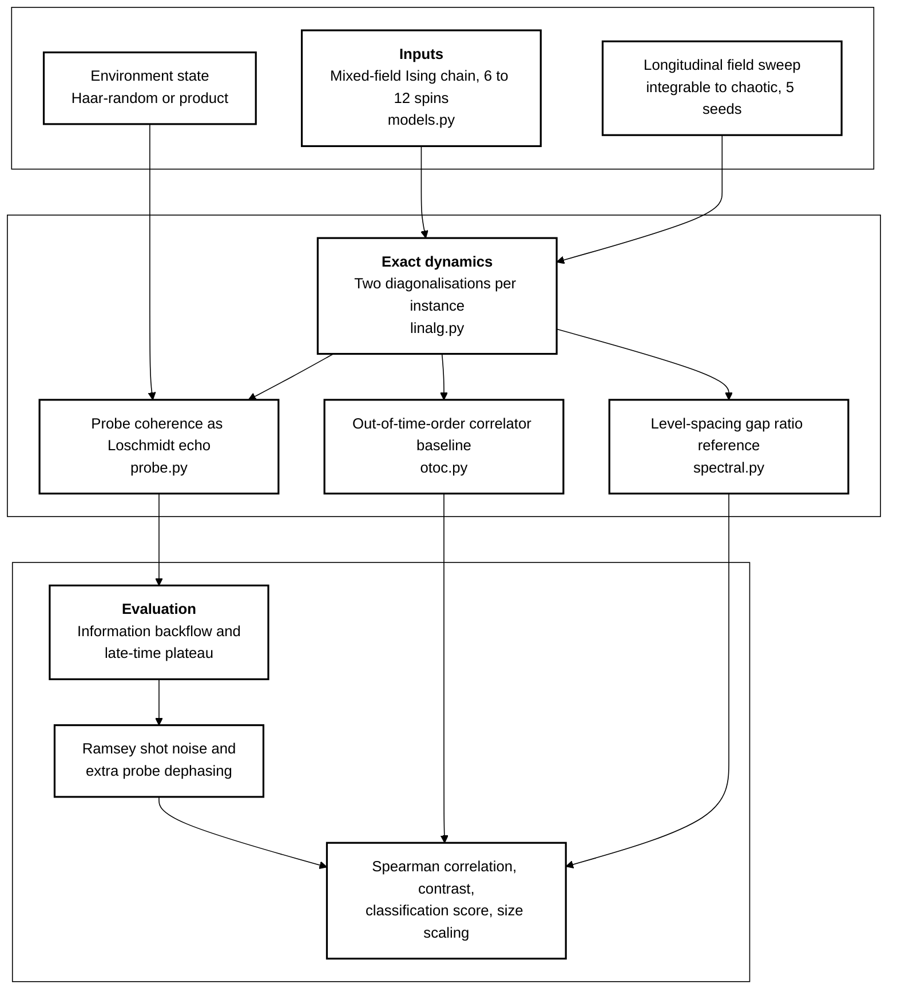
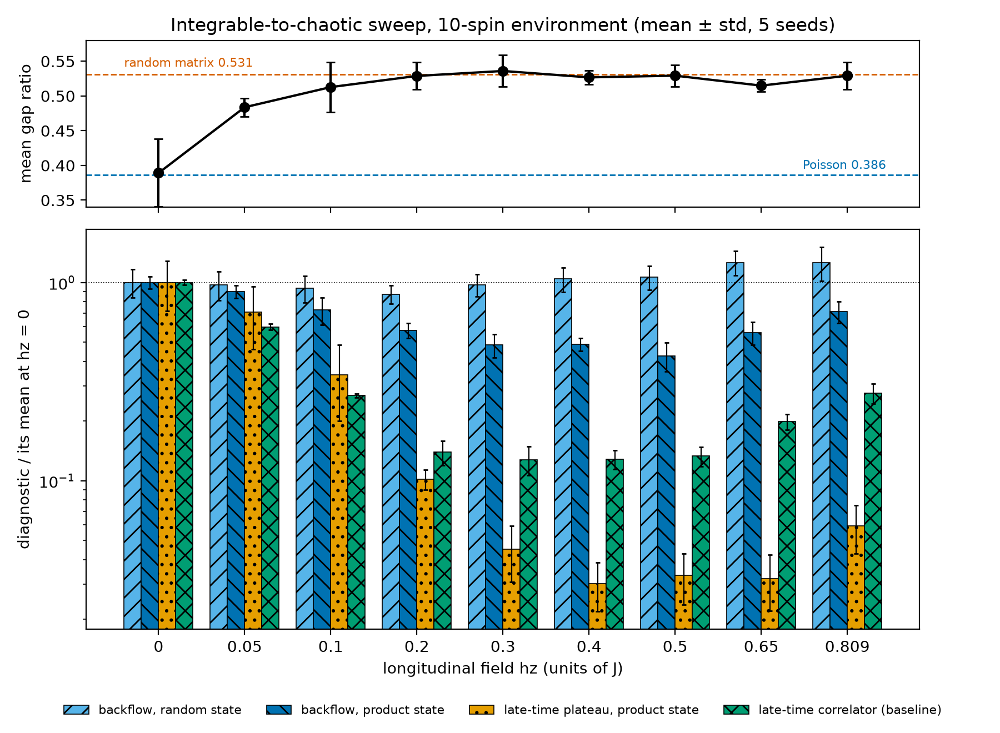
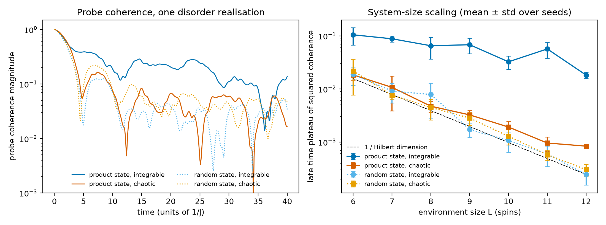
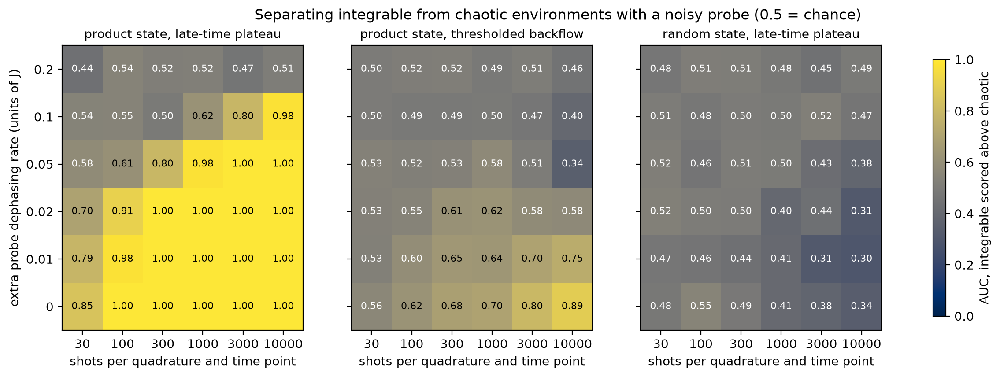
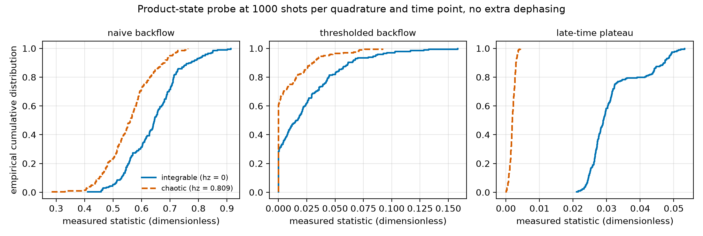

# Does a probe qubit's information backflow diagnose many-body quantum chaos?

[](LICENSE)
[](https://www.python.org/)
[](https://github.com/pradeepdegalaroyal/probe-qubit-backflow-vs-chaos-ising-environment/actions/workflows/ci.yml)

**Abstract.** A single qubit that dephases against a many-body environment has a coherence equal
to a Loschmidt echo of that environment, so its non-Markovian memory, the Breuer-Laine-Piilo (BLP)
information backflow, is a candidate one-qubit diagnostic of quantum chaos. This exact simulation
study of 6-12 spin mixed-field Ising environments finds that backflow does **not** track the
integrable-to-chaotic crossover when the environment is in a random state (Spearman correlation
with the level-spacing ratio +0.12), and is only a weak diagnostic for a product state. The
late-time plateau of the same coherence record, measured from a product state through an
integrability-preserving coupling, separates the two regimes by a factor of 16.93 and needs 100
shots per time point, but fails for a symmetry-breaking coupling at moderate strength, where an
out-of-time-order correlator (OTOC) still works.

All results are numerical simulations of small systems. No quantum advantage is claimed.

## Motivation

Many-body quantum chaos is usually diagnosed with quantities that are expensive on hardware:
level statistics need the full spectrum, and an OTOC needs backward time evolution or many
randomised measurements. Open-system theory suggests a cheaper route. The memory of a small open
system reflects the structure of its environment, so a single probe qubit could in principle
report whether the environment thermalises. If that worked, a Ramsey sequence on one ancilla would
replace a many-body measurement. Whether it works, and at what shot cost, is a concrete question
at the boundary of quantum chaos and quantum information.

## Research gap

Breuer et al. (2016, [doi:10.1103/RevModPhys.88.021002](https://doi.org/10.1103/RevModPhys.88.021002))
define memory through information backflow and propose small open systems as sensors of their
environment. Tanimura (2020, [doi:10.1063/5.0011599](https://doi.org/10.1063/5.0011599)) reviews
the hierarchical equations of motion, which are numerically exact but built for harmonic baths.
Recent quantum-information work characterises noisy channels without internal many-body
structure: relative-entropy estimation (Lu and Fang, 2026,
[doi:10.1038/s42005-026-02655-y](https://doi.org/10.1038/s42005-026-02655-y)) and transmission
through depolarising channels (Wang et al., 2026,
[doi:10.1038/s42005-026-02698-1](https://doi.org/10.1038/s42005-026-02698-1)). None of these tests
whether the memory seen by one dephasing qubit separates an integrable from a chaotic interacting
environment, or what that costs under shot noise. The full related-work table (11 papers, three
roles) is in [`docs/RESEARCH_GAP.md`](docs/RESEARCH_GAP.md).

## What is new here

- An exact test, against level-spacing statistics, of information backflow as a chaos diagnostic
  for an interacting spin environment, rather than a harmonic bath or a structureless channel.
- A like-for-like comparison of three statistics from one coherence record (naive backflow,
  shot-noise-thresholded backflow, late-time plateau) with an OTOC baseline.
- A shot-and-dephasing budget for each statistic, and a size-scaling study that separates a real
  signal from the finite-size floor set by the Hilbert-space dimension.
- A stated negative result: the infinite-temperature probe is blind to integrability, and the
  backflow it reports follows the spectral width of the environment instead.

## Hypotheses

Fixed before the experiments were run (see [`docs/RESEARCH_GAP.md`](docs/RESEARCH_GAP.md)):

| | Hypothesis | Outcome |
|---|---|---|
| H1 | With a random environment state, backflow anticorrelates with the gap ratio (Spearman at most -0.8 at 10 spins) | **Refuted** |
| H2 | Backflow decays with size at least 0.25 per site at the chaotic point and at least three times more slowly at the integrable point | **Refuted** |
| H3 | At most 1000 shots and extra dephasing up to 0.05 J give an area under the receiver operating characteristic curve (AUC) of at least 0.95 | **Refuted for backflow; met by the plateau from a product state** |
| H4 | A Pauli Z coupling, which breaks the free-fermion structure, loses the contrast of a Pauli X coupling | **Supported at coupling 0.4 and 0.8, not at 0.2** |

The product state used in the ablation was changed after the first run: the all-up state first
chosen sits at the edge of the spectrum for large longitudinal field, which confounds chaos with
energy density. It was replaced by the all-plus-y state, which has the infinite-temperature energy
density at every field value. The product-state results are therefore a follow-up analysis, not a
pre-registered test.

## Method



Legend: Haar-random means drawn uniformly from all pure states; classification score is the AUC
between the integrable and the chaotic end of the sweep.

**Environment.** H_E = J Σ Z_i Z_{i+1} + Σ hx_i X_i + hz Σ Z_i with J = 1, weakly disordered
transverse fields hx_i = 0.9045 ± 0.1 and longitudinal field hz from 0 (integrable, free fermions)
to 0.809 (chaotic).

**Probe.** One qubit with coupling λ σ_z ⊗ B, where B is Pauli X or Pauli Z on the central spin
and λ = 0.4 unless stated. Its coherence is c(t) = ⟨ψ| U₋†(t) U₊(t) |ψ⟩ with U± generated by
H_E ± λB, computed exactly.

**Statistics.** Backflow is the sum of all increases of |c(t)| up to t = 40/J. The plateau is the
mean of |c(t)|² over the second half of the record. Finite-shot versions use Ramsey readout of two
quadratures at 41 time points.

**Baselines.** Classical: mean gap ratio from exact diagonalisation (0.386 integrable, 0.531
chaotic in the ideal limits). Quantum: late-time OTOC of Pauli X on the two end spins. A
memoryless (Markovian) dephasing model gives zero backflow by construction.

Details: [`docs/METHOD.md`](docs/METHOD.md).

## Results

All numbers below are copied from `results/summary.json`, `results/sweep.csv`,
`results/scaling.csv` and `results/shots.csv`. Values are mean ± standard deviation over 5 seeds
unless stated.

### E1. Integrable-to-chaotic sweep (10 spins)

The gap ratio rises from 0.389 ± 0.049 at hz = 0 to 0.529 ± 0.020 at hz = 0.809.

| Diagnostic | Integrable (hz = 0) | Chaotic (hz = 0.809) | Contrast | AUC | Spearman vs gap ratio |
|---|---|---|---|---|---|
| Backflow, random state, X coupling | 0.296 ± 0.049 | 0.374 ± 0.072 | 0.79 | 0.16 | +0.12 |
| Plateau, random state, X coupling | 0.0011 ± 0.0004 | 0.0013 ± 0.0004 | 0.83 | 0.32 | +0.14 |
| Backflow, product state, X coupling | 0.476 ± 0.033 | 0.339 ± 0.042 | 1.40 | 1.00 | -0.53 |
| Plateau, product state, X coupling | 0.0324 ± 0.0091 | 0.0019 ± 0.0005 | 16.93 | 1.00 | -0.50 |
| Backflow, product state, Z coupling | 0.476 ± 0.186 | 0.438 ± 0.092 | 1.09 | 0.48 | -0.36 |
| Plateau, product state, Z coupling | 0.0024 ± 0.0013 | 0.0022 ± 0.0006 | 1.11 | 0.56 | -0.33 |
| Late-time OTOC (quantum baseline) | 0.621 ± 0.019 | 0.172 ± 0.020 | 3.61 | 1.00 | -0.67 |

Contrast is the integrable mean divided by the chaotic mean. AUC is computed on the exact
(noise-free) values of the 5 + 5 end-point instances; 0.5 is chance.



*Figure 1. Only the product-state plateau and the OTOC fall by an order of magnitude as the
environment becomes chaotic; random-state backflow stays flat and then rises.*

**H1 is refuted.** With a random environment state the backflow does not decrease with chaos. It
correlates instead with the spectral width of the environment (Spearman +0.48, p = 0.0008): the
coherence sits on a finite-size floor in both regimes, and a wider spectrum makes that floor
fluctuate faster, which the backflow sum counts as memory.

### E2. System-size scaling (6 to 12 spins)

| Quantity | Decay rate per site | Reference |
|---|---|---|
| Plateau, random state, integrable | 0.732 ± 0.051 | ln 2 = 0.693 |
| Plateau, random state, chaotic | 0.686 ± 0.027 | ln 2 = 0.693 |
| Backflow, random state, integrable | 0.305 ± 0.015 | ln 2 / 2 = 0.347 |
| Backflow, random state, chaotic | 0.230 ± 0.015 | ln 2 / 2 = 0.347 |
| Plateau, product state, integrable | 0.243 ± 0.062 | |
| Plateau, product state, chaotic | 0.536 ± 0.031 | |

Rates are slopes of the logarithm of the seed-averaged statistic against chain length, ± fit
standard error.



*Figure 2. For a random state both regimes follow the inverse Hilbert-space dimension; only the
product state in the integrable chain stays above it.*

**H2 is refuted.** For a random state, backflow decays faster at the integrable point (0.305 per
site) than at the chaotic point (0.230 per site), the opposite of the hypothesis, and the plateau
decays at the rate ln 2 expected from the Hilbert-space dimension in both regimes. For the product
state the plateau contrast grows from 16.93 at 10 spins to 21.79 at 12 spins (3 seeds: 0.0182 ±
0.0025 against 0.00084 ± 0.00008).

### E3. Ablation: coupling operator, coupling strength, environment state (10 spins)

Plateau contrast (integrable over chaotic), with the exact end-point AUC in brackets:

| Coupling | λ | Random state | Product state |
|---|---|---|---|
| X | 0.2 | 0.25 (0.00) | 14.28 (1.00) |
| X | 0.4 | 0.83 (0.32) | 16.93 (1.00) |
| X | 0.8 | 0.94 (0.48) | 8.50 (1.00) |
| Z | 0.2 | 14.22 (1.00) | 11.35 (1.00) |
| Z | 0.4 | 0.64 (0.12) | 1.11 (0.56) |
| Z | 0.8 | 1.29 (0.72) | 0.74 (0.16) |

**H4 is supported at λ = 0.4 and 0.8 and not at λ = 0.2.** The X coupling keeps both echo
branches free-fermionic at hz = 0 and the product-state plateau separates the regimes at every
coupling strength. The Z coupling makes the branches interacting; the contrast disappears at
moderate and strong coupling but survives at weak coupling, for both environment states.

### E4. Shot noise and extra probe dephasing (10 spins)



*Figure 3. The product-state plateau reaches AUC 0.95 or more from 100 shots and tolerates
dephasing up to 0.1 J at 10000 shots; thresholded backflow and the random-state probe never do.*



*Figure 4. At 1000 shots the plateau distributions of the two regimes do not overlap, while both
backflow estimators overlap heavily.*

| Statistic (product state, X coupling) | AUC at 100 shots, no dephasing | AUC at 1000 shots, dephasing 0.05 J | AUC at 10000 shots, no dephasing |
|---|---|---|---|
| Late-time plateau | 0.998 | 0.980 | 1.000 |
| Thresholded backflow | 0.623 | 0.576 | 0.891 |
| Naive backflow | 0.815 | 0.547 | 0.861 |

**H3 is refuted for backflow and met by the plateau.** Neither backflow estimator reaches AUC 0.95
anywhere on the grid. With a random environment state no statistic exceeds 0.57; thresholded
backflow reaches 0.128 at 10000 shots, which means it ranks the chaotic environment above the
integrable one. At an extra dephasing rate of 0.2 J the plateau is at chance (0.44 to 0.54).

## Discussion

1. **Backflow is not a chaos diagnostic at this scale.** A probe coupled to a finite environment
   in a typical state loses its coherence down to a floor of order the inverse square root of the
   Hilbert-space dimension, in the integrable chain as much as in the chaotic one. The backflow
   then measures how fast that floor fluctuates, which follows the spectral width.
2. **The information is in the level of the coherence, not in its revivals.** For a product state
   and an integrability-preserving coupling, the plateau separates the regimes by 16.93 and the
   backflow by 1.40. The plateau is also the cheaper statistic: it averages many time points,
   while backflow sums noisy differences.
3. **The probe diagnoses the dressed environment.** With the Z coupling the two echo branches are
   themselves non-integrable, and at λ = 0.4 the probe reports "chaotic" even for a free-fermion
   chain. The probe result therefore depends on whether the coupling respects the structure that
   makes the environment integrable. The OTOC baseline does not have this problem and has AUC 1.00
   with a smaller contrast (3.61).
4. **Non-monotonic behaviour.** The product-state plateau and the OTOC both rise again between
   hz = 0.5 and 0.809 (Figure 1), while the gap ratio stays near the random-matrix value. Neither
   is a monotone function of the gap ratio inside the chaotic regime, which limits the Spearman
   correlations to about -0.5 and -0.67.

## Limitations

- Exact simulation of at most 12 environment spins and one model family; the size trends are
  measured over 6-12 spins only and are not extrapolated.
- Five disorder seeds (three at 12 spins); AUC values on 5 + 5 exact instances are coarse.
- The integrable point is free-fermionic. Interacting integrable models were not tested.
- The time window (40/J) and the plateau window (its second half) are fixed, not optimised.
- Noise is modelled as shot noise plus exponential probe dephasing. Probe relaxation, readout
  error and imperfect preparation of the environment state are not included.
- The OTOC baseline is evaluated without shot noise, so its shot cost is not compared.
- The product-state analysis was added after the first run and is not pre-registered.

## Future work

- **Hardware setting.** The protocol is one ancilla, a controlled local rotation and Ramsey
  readout, which fits trapped-ion and superconducting processors. The measured tolerance (probe
  dephasing up to about 0.1 J at 10000 shots) sets the coherence the ancilla needs relative to the
  environment coupling.
- **Symmetry-resolved probes.** The coupling dependence suggests choosing probe operators by the
  symmetry sector they preserve, and testing interacting integrable chains and models with
  higher-form or non-invertible symmetries.
- **Larger environments.** Matrix-product-state evolution would extend the product-state plateau
  to chain lengths where the Hilbert-space floor is negligible.
- **Shot-fair baseline.** Add shot noise and randomised-measurement cost to the OTOC.

## Reproducibility

```bash
pip install -r requirements.txt
python -m pytest -q                      # 8 unit tests
python experiments/run_all.py --quick    # smoke run, writes results/quick and figures/quick
python experiments/run_all.py            # full study, writes results/ and figures/
```

The full study took 260.6 s of compute (281 s wall clock) on an NVIDIA RTX 5050 laptop graphics
processing unit (GPU) with Python 3.11.9 and PyTorch 2.11; the smoke run took about 30 s. The code
falls back to the central processing unit when no GPU is present, where the 11- and 12-spin diagonalisations are much
slower. Seeds are fixed in `experiments/run_all.py`.

## Project structure

```
src/chaosprobe/     models.py (Ising chain), probe.py (echo, backflow, shot model),
                    otoc.py, spectral.py (gap ratio), stats.py, linalg.py, plotting.py
experiments/        run_all.py (one command for all results and figures)
tests/              test_core.py (8 tests against explicit matrix exponentials)
docs/               RESEARCH_GAP.md, METHOD.md
results/            sweep.csv, scaling.csv, ablation.csv, shots.csv, shot_samples.csv,
                    example_traces.csv, summary.json
figures/            four figures used above
```

## Related work by the author

- [shot-cost-of-non-markovian-memory-witnesses](https://github.com/pradeepdegalaroyal/shot-cost-of-non-markovian-memory-witnesses):
  shot budgets for certifying information backflow on a single qubit with a classical noise model.
- [heralded-vs-unheralded-noise-monitored-clifford](https://github.com/pradeepdegalaroyal/heralded-vs-unheralded-noise-monitored-clifford):
  a reference qubit as a probe of information retention in monitored many-body circuits.

## Citation

```bibtex
@software{chenchupradeep2026probebackflow,
  author  = {Chenchupradeep, Degala},
  title   = {Does a probe qubit's information backflow diagnose many-body quantum chaos? An exact study on mixed-field Ising environments},
  year    = {2026},
  version = {1.0.0},
  url     = {https://github.com/pradeepdegalaroyal/probe-qubit-backflow-vs-chaos-ising-environment},
  license = {MIT}
}
```

MIT license (`LICENSE`). Citation metadata is also provided in `CITATION.cff`.
